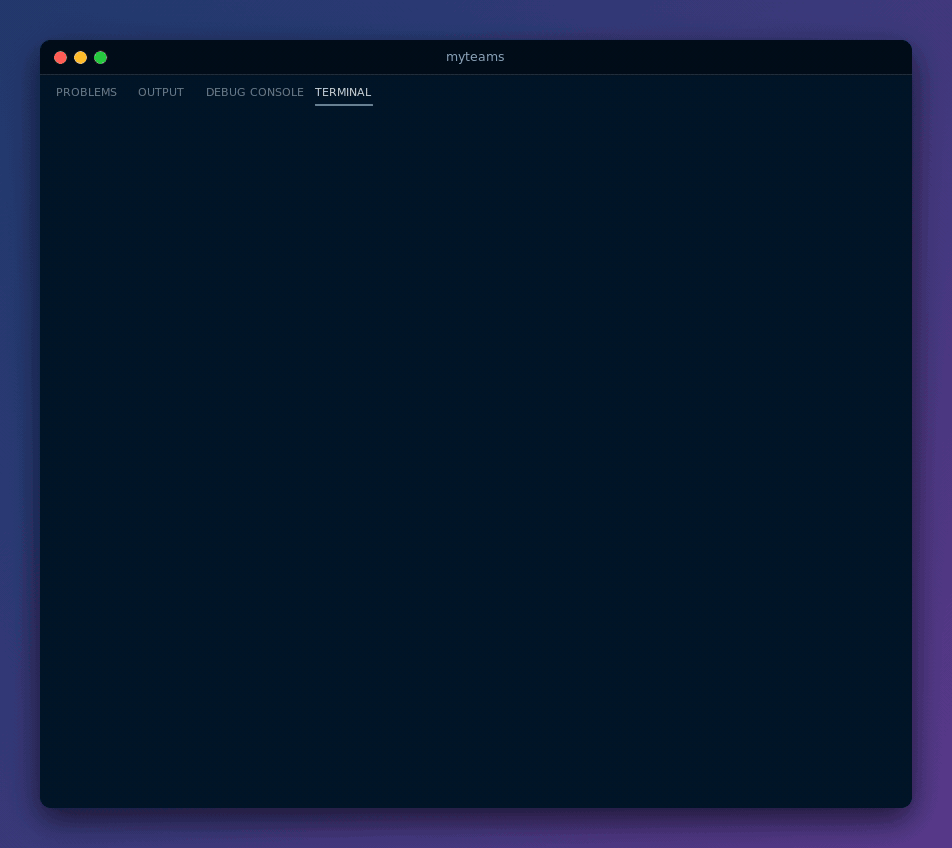
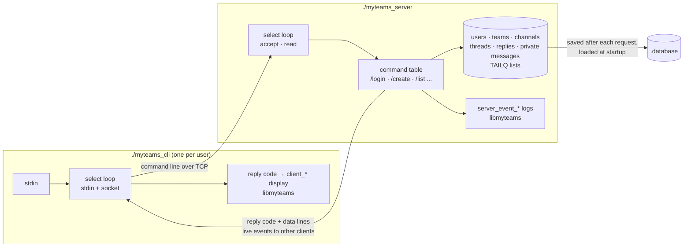

<div align="center">

# myteams: a Microsoft Teams-like chat server and CLI client in C

**One server, any number of terminal clients: teams, channels, threads, replies and private messages over plain TCP, multiplexed with `select()` and saved to disk.**


-555)




[Quick start](#quick-start) · [Commands](#commands) · [How it works](#how-it-works) · [Team](#team)

</div>

---

## About

myteams is the Network Programming project of Epitech's second year. The brief: write a collaborative messaging server and its command-line client, in the spirit of Microsoft Teams. Users log in, create teams, open channels inside them, start threads in channels and reply to threads, subscribe to the teams they care about, and send each other private messages.

Server-side event logs and everything a client shows to its user go through `libmyteams`, a logging library provided by Epitech, so that the output format is fixed and the project can be graded automatically.

## Highlights

- **Single-threaded `select()` server**: one loop watches the listening socket and every client socket, accepts new connections and dispatches commands, with no threads and no `fork()`.
- **Four-level hierarchy**: teams contain channels, channels contain threads, threads contain replies. Every user, team, channel and thread gets a UUID from `libuuid`, and everything is stored in `TAILQ` linked lists from `<sys/queue.h>`.
- **Live notifications**: when someone replies in a thread, every connected user subscribed to that team receives the reply immediately; a private message pops up on the recipient's terminal as soon as it is sent.
- **Persistence**: the whole state (users, subscriptions, teams, channels, threads, replies, private messages) is written to a plain-text `.database` file after every request and reloaded when the server starts.
- **Documented protocol**: each command answers with a numeric reply code followed by its data lines, and the client maps every code to the matching display function. The mapping is in [`RFC_doc.md`](RFC_doc.md).
- **Event-driven client**: the client watches both its standard input and the server socket with `select()`, so incoming events are printed even while the user is idle.

## Quick start

### Prerequisites

`libmyteams.so` ships as a prebuilt x86-64 Linux library, so the project builds and runs on x86-64 Linux.

| Tool | Debian / Ubuntu package |
|------|-------------------------|
| gcc and make | `build-essential` |
| libuuid | `uuid-dev` |

### Build and run

```bash
git clone https://github.com/yanishk/myteams.git
cd myteams
make                                     # builds ./myteams_server and ./myteams_cli
export LD_LIBRARY_PATH=$PWD/libs/myteams # where libmyteams.so lives

./myteams_server 4242                    # terminal 1
./myteams_cli 127.0.0.1 4242             # terminal 2, 3, ...
```

`./myteams_server -help` and `./myteams_cli -help` print the usage. The server keeps its data in `.database` in the directory it is started from; delete that file to start from scratch.

### Commands

Arguments are always wrapped in double quotes.

| Command | Action |
|---------|--------|
| `/login "name"` | Log in, creating the user on first login |
| `/logout` | Log out |
| `/users` | List every user and whether they are connected |
| `/user "user_uuid"` | Show one user |
| `/send "user_uuid" "message"` | Send a private message |
| `/messages "user_uuid"` | Show the private messages exchanged with a user |
| `/subscribe "team_uuid"` | Subscribe to a team and receive its events |
| `/subscribed ["team_uuid"]` | List your teams, or the users subscribed to a team |
| `/unsubscribe "team_uuid"` | Unsubscribe from a team |
| `/use ["team_uuid" ["channel_uuid" ["thread_uuid"]]]` | Set the context for the commands below |
| `/create ...` | In no context: `"name" "description"` creates a team. In a team: a channel. In a channel: `"title" "message"` starts a thread. In a thread: `"body"` posts a reply |
| `/list` | List the teams, channels, threads or replies of the current context |
| `/info` | Show the current user, team, channel or thread |

A typical session: `/login`, `/create` a team, `/subscribe` to it, `/use` it and `/create` a channel, `/use` the channel and `/create` a thread, then other users `/subscribe`, `/use` the thread and `/create` replies.

## How it works



The client sends each line typed by the user as-is. The server splits it on double quotes, looks the command up in a table of fourteen handlers and runs it against the in-memory data. The answer starts with a numeric code (`201 Client logged in.`, `214 Print team created.`, `401 Error unknown user.`...) followed by the data lines and an end-of-transmission marker; the client picks the `libmyteams` function that matches the code and passes it the data. Replies and private messages are also written to the sockets of the other users concerned, which is how notifications reach them live.

The `/use` context is kept on the server in a single slot shared by every connection, so two clients working in different threads at the same time should each run `/use` again before posting.

```
server/        select() loop, client management, command handlers
  src/commands/  login, users, private messages, subscriptions, /use, create/, list/, info/
  src/database/  .database writer and parser
client/        Terminal client: connection, select() loop, reply-code dispatch to libmyteams
lib/           String and array helpers shared by both binaries
libs/myteams/  libmyteams.so and its logging headers (provided by Epitech)
RFC_doc.md     Every command, its reply codes and the client function each one triggers
```

## Team

Built in two weeks (April 2024) by three Epitech students:

| | Main areas |
|---|---|
| [**Yanis Harkouk**](https://github.com/yanishk) | TCP server and `select()` loop, saving and loading all data in `.database`, `/use` context, shared data model (`teams.h`), server/client layout and Makefile |
| [**Eva Legrand**](https://github.com/Chaegnal) | `/create` for teams, channels, threads and replies, `/list`, `/info`, subscriptions, private messages (`/send`, `/messages`), `/login` and user lookups, live reply and message notifications |
| [**Mathis Brehm**](https://github.com/mathisbdkr) | CLI client (connection and `select()` loop), display of server replies through libmyteams, reply-code protocol (`RFC_doc.md`), server-side event logging and reply messages, first command dispatcher and argument tokenizer |

## License

Educational project (Epitech, 2024). `libmyteams` and its headers are provided by Epitech.
